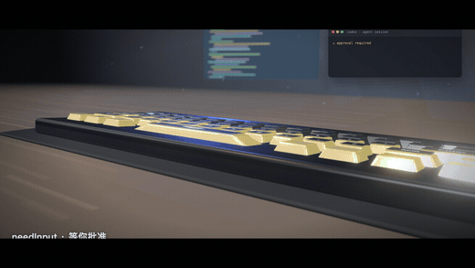
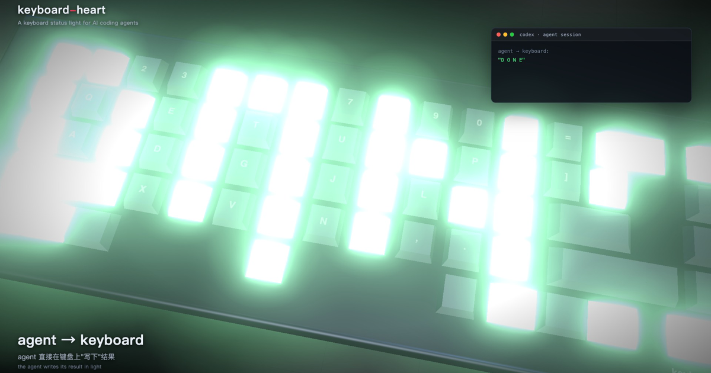

# keyboard-heart ⌨️❤️

English | [简体中文](README.md)

**A keyboard status light for Codex, Claude Code, and every AI coding tool**: AI finishes a task → a green wave sweeps the keyboard; an error → red pulses ×3 from the top-right; waiting for your approval → amber rows growing from the bottom. A local REST + WebSocket service with two ways to wire it up:

- **Hooks (zero AI awareness)**: add one `notify` / `hooks` line to Codex, merge a JSON block into Claude Code — every reply or permission request lights up automatically
- **Prompt-driven (AI in control)**: paste the preset prompt into CLAUDE.md / AGENTS.md and the AI signals `processing` / `success` / `failure` / `needInput` on its own

Raw per-key REST + WebSocket control is open to any script.

> Protocol independently reverse-engineered (WebHID traffic analysis). No vendor driver, no vendor console required.

  

<div align="center">

<br>
<sub>heartbeat preset · 3D render running the exact animation math of the real device</sub>
<br><br>
<video src="promo/out/keyboard-heart-3d.mp4" poster="promo/out/og.png" controls muted loop playsinline width="92%"></video>
<br>
<sub><strong>3D promo</strong>: six presets × cinematic camera (25 s, 1080p)</sub>
</div>

## Promo videos

Two 3D-rendered promos (rendered with the exact animation math of the real device):

| Edition | Style | Files |
|---|---|---|
| 🤍 White · Apple style | white/silver board, seamless light studio, colored LED tint | [keyboard-heart-3d.mp4](promo/out/keyboard-heart-3d.mp4) · [GIF](promo/out/hero.gif) |
| 🖤 Dark · night | walnut desk, moody night, neon bloom | in git history |

<div align="center">
<br>
<sub>agent → keyboard: "D O N E"</sub>
</div>

## Wire up your AI in 30 seconds

**Codex** (`~/.codex/hooks.json`, recommended):

```json
{ "_keyboard_heart": true, "hooks": [{ "type": "command", "command": "curl -s -X POST http://127.0.0.1:8791/fx/success >/dev/null 2>&1 || true" }] }
```

**Claude Code** (merge into `~/.claude/settings.json`): see [integrations/claude-code-hooks.json](integrations/claude-code-hooks.json).

**Any AI / script** (one curl):

```bash
curl -X POST localhost:8791/fx/success
```

Full integration guide in [AI coding tools](#ai-coding-tools) below.

## Supported keyboards

Three backends covering **12 MCHOSE models (direct) + hundreds of OpenRGB devices + 1000+ QMK/VIA configurations**:

### ① MCHOSE direct (`KB_BACKEND=hid`, default) — 12 models

Independently reverse-engineered protocol (55 DD realtime streaming + cmd=06 side-bar config), device support driven by data files in `profiles/`.

**Verified on real hardware (1)**

| Keyboard | USB ID |
|---|---|
| MCHOSE Ace 68 Air 2 | `0x3837:0x300A` |

**Community tables, plug & play (2)**

| Keyboard | USB ID | Source |
|---|---|---|
| MCHOSE Ace 68 (wired) | `0x41E4:0x2116` | SignalRGB community plugin |
| MCHOSE Ace 68 (sequential LED) | `0x41E4:0x2114` | Community PR |

**Tables extracted, awaiting real-device calibration (9)**: Ace 68 air ii / air iii / gt / i / iii / pro / turbo 8k / turbo 16k / v2 iii — key tables auto-extracted from vendor console assets (68/68 keys matched), listed by `kbctl doctor`; adoption flow in the [contributing guide](docs/CONTRIBUTING-PROFILES.md).

**Same route, not yet unlocked (22 MCHOSE models)**: ACE60/Pro/X series, ACE75, G75 v2, G87 v2, G98, GOD60, GT75, JET75, K87, K99, MIX87, ZERO75X, etc. (needs a layout file for each size first).

### ② OpenRGB ecosystem (`KB_BACKEND=openrgb`) — hundreds of devices, 100+ brands, full per-key

Point it at the [OpenRGB](https://openrgb.org) SDK (127.0.0.1:6742) and get per-key control: all six presets, the per-key API and WS frame stream work as-is. Covers keyboards/mice/mousepads/strips from Corsair, Razer, Logitech, SteelSeries, ASUS ROG, MSI, Redragon, Womier and more.

### ③ QMK / VIA (`KB_BACKEND=via`) — 1000+ configurations, ambient

Any QMK keyboard with VIA enabled (raw HID 0xFF60:0x61). Stock QMK firmware only exposes global brightness/color/effect (no per-key protocol), so animations degrade to their average color — semantics preserved (success green / failure red / needInput amber), ideal as a task-status ambient light.

⚠️ USB wired mode only; 2.4G/Bluetooth dongles do not expose the lighting interface.

## Quickstart

```bash
git clone https://github.com/lengjingxu/keyboard-heart && cd keyboard-heart
npm install

# 1. Self-check: find the keyboard, verify permissions
npm run doctor

# 2. Start the service (default 127.0.0.1:8791, localhost only)
npm start

# 3. Play
npm link          # first time: put kbctl on your PATH
kbctl fx success
```

## Let an AI install it for you

Paste this into any AI coding assistant (ZCode / Claude Code / Cursor…):

```text
Please install and start keyboard-heart (https://github.com/lengjingxu/keyboard-heart):
1. Clone it, run npm install and npm run doctor to self-check
2. Start the service in the background (npm start) and confirm kbctl health reports the device online
3. Register autostart (./install.sh --launchd or --systemd)
4. Verify with kbctl fx success and tell me how to call it from automation
```

## The six presets

| Preset | Trigger | Effect |
|---|---|---|
| `success` | task completed | green wave sweeping from bottom-left |
| `failure` | error / failure | red pulse bursts ×3 from top-right |
| `needInput` | waiting for you | amber rows grow up, retract, bottom row breathes (sticky) |
| `notify` | generic notification | white ripple from center |
| `processing` | working on it | cyan comet orbiting the perimeter (sticky) |
| `heartbeat` | pure delight | small red heart, double thump |

Priority: `failure` > `success`/`notify`/`needInput` > `processing`/`heartbeat`. Sticky animations are preempted by higher-priority events and fall back to the static frame; `force: true` overrides.

## API

### REST (default `http://127.0.0.1:8791`)

```bash
curl -X POST localhost:8791/fx/success          # play a preset
curl -X POST localhost:8791/fx/processing      # optional: {"force":true}

curl -X POST localhost:8791/keys \              # light arbitrary keys statically
  -H 'Content-Type: application/json' \
  -d '{"keys":{"Q":"#ff0000","Space":"#00ff88"}}'

curl -X POST localhost:8791/keys -d '{"all":"#202020"}'
curl -X POST localhost:8791/keys -d '{"grid":[["#ff0000",0,0,"#00ff00"]]}'  # 16×5 grid

curl -X POST localhost:8791/side \              # side light bar
  -d '{"color":"#00ff88","brightness":70}'      # brightness 0-100

curl -X POST localhost:8791/clear               # clear static frame + stop animation
curl -X POST localhost:8791/off                 # everything off (side bar too)
curl localhost:8791/health                      # device online status
```

### WebSocket (bring your own animation)

```js
const ws = new WebSocket('ws://127.0.0.1:8791/stream');
setInterval(() => {
  ws.send(JSON.stringify({ op: 'frame', keys: { Q: '#ff2020' } }));  // frames merge into the static buffer; the server streams at 20fps
}, 50);
// op: frame(keys|all|grid) | side | clear | fx | health
```

Architecture note: **single writer** (one process owns the HID device), all clients merge into a 20fps scheduler — the onboard effect engine repaints constantly, so only continuous streaming keeps a custom picture stable (key protocol finding).

### kbctl cheat sheet

```bash
kbctl fx <name>            # the six presets
kbctl key Q=ff0000 A=00ff00
kbctl all RRGGBB
kbctl side RRGGBB [0-100]
kbctl clear | off
kbctl health | state
kbctl doctor               # no service needed, probes the device directly
```

KB_HOST/KB_PORT env vars point at a remote service.

## Universal backends: OpenRGB & QMK/VIA

Beyond MCHOSE direct HID, keyboard-heart speaks two **universal standards** (pick with `KB_BACKEND`):

### OpenRGB (recommended full-color per-key backend)

[OpenRGB](https://openrgb.org) supports hundreds of RGB devices. Start OpenRGB (enable the SDK server, port 6742), then:

```bash
KB_BACKEND=openrgb npm start
```

- Auto-discovers keyboards on the server (`KB_OPENRGB_DEVICE=<index|name>` to pin one)
- Maps LED names onto the 65% grid — all six presets, the per-key API and WS frames **work as-is**
- LEDs whose names don't match render by their own index, so full-board patterns stay intact

### VIA / QMK (ambient backend)

Any QMK keyboard with VIA enabled (raw HID 0xFF60:0x61):

```bash
KB_BACKEND=via npm start
```

⚠️ Stock QMK firmware only exposes **global** brightness/color/effect (per-key color is not in the standard protocol), so the VIA backend degrades per-key animations to their average color — think "task status ambient light". Preset semantics survive: success green, failure red, needInput amber.

Default `KB_BACKEND=hid` uses the MCHOSE direct protocol (profiles/).

## AI coding tools

Two routes, stackable: **hooks** (tool lifecycle events wired straight to the lights, AI unaware) + **prompt-driven** (in CLAUDE.md/AGENTS.md, the AI calls on its own).

### Claude Code (hooks)

Merge [integrations/claude-code-hooks.json](integrations/claude-code-hooks.json) into `~/.claude/settings.json` (or the project-level `.claude/settings.json`), or add via `/hooks`:

- `Stop` (Claude finished responding) → `fx success`
- `Notification` (permission prompt / waiting for input) → `fx needInput`

### Codex CLI

**Hooks (recommended, needs Codex `features.hooks = true`)**: append one entry each to the `Stop` / `PermissionRequest` arrays in `~/.codex/hooks.json`:

```json
{ "_keyboard_heart": true, "hooks": [{ "type": "command", "command": "curl -s -X POST http://127.0.0.1:8791/fx/success >/dev/null 2>&1 || true" }] }
```

(Use needInput for `PermissionRequest`; Codex asks for trust confirmation on first fire.)

**notify bridge (fallback)**: without hooks, add to `~/.codex/config.toml` (absolute path; Codex supports a single `notify`):

```toml
notify = ["/absolute/path/to/keyboard-heart/integrations/codex-notify.sh"]
```

The bridge maps events: turn complete → `success`, approval requested → `needInput`, anything else → `notify`.

### Prompt-driven (any agent reading CLAUDE.md / AGENTS.md)

Paste [integrations/agent-prompt.md](integrations/agent-prompt.md) into your project's CLAUDE.md / AGENTS.md — the AI will signal `processing` on long tasks, `success`/`failure` on completion, `needInput` when it needs you.

### ZCode / any automation

One curl (PostToolUse hook, workflow, cron…):

```bash
curl -X POST localhost:8791/fx/success
```

Recommended for long tasks: `processing` at the start, `success` or `failure` at the end.

## Architecture

```
lib/grid.js        profile loader + 16×5 grid geometry (key name → LED slot maps)
lib/device.js      HID transport: 55 DD 7-packet streaming / cmd=06 side config / replug recovery
lib/backends/      OpenRGB SDK client + VIA raw HID (KB_BACKEND)
lib/animations.js  the six presets (parameterized geometry, easy to tweak)
lib/scheduler.js   single-writer 20fps frame scheduler + priority preemption + static recovery
server.js          REST + WS (binds 127.0.0.1 only)
bin/kbctl.js       CLI client
heart.js           offline CLI (drives the device directly, no service needed)
```

Adding a keyboard: drop a JSON profile into `profiles/` — no code changes. Three extraction routes and the real-device calibration checklist live in the [contributing guide](docs/CONTRIBUTING-PROFILES.md).

## Acknowledgments

- [Luk-Krn/mchose_ace68](https://github.com/Luk-Krn/mchose_ace68) — SignalRGB plugin for the wired Ace 68, this project's starting point
- The MCHOSE web console — source of the matrix key tables and side-bar config protocol

## License

MIT
